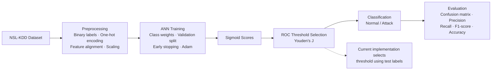

# System Architecture and Technical Design

## 1. System Overview

The project is an offline, supervised binary-classification prototype for network intrusion detection. It uses the NSL-KDD dataset and a feed-forward Artificial Neural Network (ANN) implemented with TensorFlow/Keras.

Each dataset row represents a network connection described by traffic and connection-level attributes. The model learns to classify each record as:

- **Normal (0):** a record labelled `normal` in the dataset.
- **Attack (1):** any record whose label is not `normal`.

The implementation is a dataset-based classifier. It does not capture packets, inspect live interfaces, or enforce firewall actions.

## 2. Dataset Layer

The implementation reads two files:

- `KDDTrain+.txt` — training records.
- `KDDTest+.txt` — test records.

A  feature-name list is supplied to Pandas when reading the files. The list includes connection attributes, the target `label`, and the `difficulty` field.

The `difficulty` field is removed before model training. The target label is converted to a binary representation.

## 3. Preprocessing Pipeline

### 3.1 Binary target conversion

The target transformation is:

```python
0 if label == 'normal' else 1
```

This makes the task a binary classification problem. It also combines all attack categories into one positive class, so the model does not distinguish between individual attack families.

### 3.2 Remove the difficulty field

The `difficulty` column is removed from both dataframes. It is not supplied to the neural network as an input feature.

### 3.3 One-hot encoding

`pandas.get_dummies()` converts categorical columns, such as `protocol_type`, `service`, and `flag`, into numerical indicator columns. This allows the model to receive numerical input.

### 3.4 Feature alignment

The training and testing dataframes are aligned using the training columns as the reference:

```python
train, test = train.align(test, join='left', axis=1, fill_value=0)
```

Missing test columns are filled with zero. Test-only dummy columns are not retained by this left join. This is a limitation for categories present only in the test set; a fitted encoder with explicit unknown-category handling would be more robust.

### 3.5 Separate predictors and target

The `label` column is separated from each dataframe:

- `X_train`, `X_test`: input features.
- `y_train`, `y_test`: binary target labels.

### 3.6 Standardization

A `StandardScaler` is fitted on the training features and then applied to both training and test features:

```python
X_train = scaler.fit_transform(X_train)
X_test = scaler.transform(X_test)
```

For each feature, standardization subtracts the training mean and divides by the training standard deviation. Fitting only on training data avoids using test-set statistics during preprocessing.

## 4. Neural Network Architecture

The network is a fully connected feed-forward ANN built using Keras' `Sequential` API.

| Stage | Layer | Configuration | Function |
|---|---|---|---|
| Input | Dense | 256 neurons, ReLU, L2(1e-4) | Learns an initial representation from the input features |
| Regularization | BatchNormalization | Default Keras settings | Normalizes layer activations during training |
| Regularization | Dropout | 0.4 | Randomly drops a fraction of activations during training |
| Hidden | Dense | 128 neurons, ReLU, L2(1e-4) | Learns higher-level feature combinations |
| Regularization | BatchNormalization + Dropout | Dropout 0.3 | Stabilizes and regularizes learning |
| Hidden | Dense | 64 neurons, ReLU, L2(1e-4) | Further transforms learned representations |
| Regularization | BatchNormalization + Dropout | Dropout 0.3 | Adds normalization and regularization |
| Hidden | Dense | 32 neurons, ReLU | Produces a compact learned representation |
| Output | Dense | 1 neuron, Sigmoid | Produces a score between 0 and 1 |

The input dimension is determined dynamically using `X_train.shape[1]`, so it matches the number of features after encoding and alignment.

### 4.1 Activation functions

- **ReLU:** introduces non-linearity in hidden layers and returns `max(0, x)`.
- **Sigmoid:** maps the output to a value between 0 and 1, interpreted as the model's estimated score for the positive class (Attack).

### 4.2 Regularization components

- **L2 regularization:** adds a penalty based on the squared magnitude of selected layer weights to the training objective.
- **Batch Normalization:** normalizes intermediate activations using batch statistics during training and moving statistics during inference.
- **Dropout:** randomly sets a proportion of activations to zero during training to reduce reliance on particular units. It is inactive during inference.

These techniques are intended to improve optimization stability and reduce overfitting; their effectiveness must be assessed from validation and test behaviour.

## 5. Model Compilation and Optimization

The model is compiled with:

- **Loss:** Binary Crossentropy, appropriate for binary classification with a sigmoid output.
- **Optimizer:** Adam with an initial learning rate of 0.001.
- **Metric:** Accuracy, tracked during training and validation.

During training, the model performs forward propagation to generate predictions. The loss measures prediction error. Backpropagation computes gradients, and Adam uses those gradients to update trainable parameters.

## 6. Class-Imbalance Handling

Scikit-learn's `compute_class_weight(class_weight='balanced', ...)` calculates weights inversely related to class frequencies in the training labels.

The resulting mapping is passed to `model.fit()` through `class_weight`. This changes the contribution of samples from each class to the training loss. It does not create additional records or rebalance the dataset itself.

## 7. Training and Validation Controls

The supplied training configuration is:

| Parameter | Value | Meaning |
|---|---:|---|
| Maximum epochs | 50 | Maximum number of full passes through the training portion |
| Batch size | 256 | Number of samples processed per training batch |
| Validation split | 0.2 | Fraction of the supplied training arrays reserved for validation |
| EarlyStopping patience | 7 | Waits for seven monitored epochs without validation-loss improvement |
| ReduceLROnPlateau factor | 0.5 | Multiplies the learning rate by 0.5 after a plateau |
| ReduceLROnPlateau patience | 3 | Waits three monitored epochs before reducing the learning rate |
| Minimum learning rate | 1e-6 | Lower bound for the scheduled learning rate |

EarlyStopping monitors `val_loss` and restores the weights from the best monitored epoch. ReduceLROnPlateau also monitors `val_loss` and reduces the learning rate when progress plateaus.

Keras takes the validation split from the end of the supplied arrays before shuffling the remaining training samples. If the row order has structure, a separately constructed and stratified validation set may be preferable.

## 8. Prediction and Thresholding

The sigmoid output is obtained with `model.predict(X_test)`. Each value is a score between zero and one.

The supplied implementation calculates an ROC curve and selects the threshold that maximizes Youden's J statistic:

```
Youden's J = True Positive Rate - False Positive Rate
```

The selected threshold is then used to convert probabilities into binary labels:

- Score greater than or equal to threshold → Attack (1).
- Score below threshold → Normal (0).

**Evaluation caveat:** the current script calculates the ROC curve with `y_test` and selects the threshold from those test labels. It then reports metrics on the same test set. This is test-set leakage through threshold selection. For an unbiased final test evaluation, select the threshold using validation predictions and validation labels, freeze it, and evaluate once on the untouched test set.

## 9. Evaluation

The script reports several complementary metrics:

- **Accuracy:** proportion of all predictions that are correct.
- **Precision:** proportion of predicted attacks that are actual attacks.
- **Recall:** proportion of actual attacks detected.
- **F1-score:** harmonic mean of precision and recall.
- **Support:** number of actual examples in each class.
- **Confusion matrix:** counts of true negatives, false positives, false negatives, and true positives.

The Keras `model.evaluate()` call uses the compiled binary-accuracy metric with its default threshold (0.5). The later confusion matrix and classification report use the ROC-selected threshold. These values can therefore differ and should be labelled clearly.

The script also computes training and test accuracy using the selected threshold. Training accuracy is an in-sample metric and should not be treated as evidence of generalization.

## 10. Visualization Layer

The implementation generates five visual outputs:

1. Training versus validation accuracy by epoch.
2. Training versus validation loss by epoch.
3. Confusion-matrix heatmap.
4. Distribution of Normal and Attack predictions.
5. Training versus test accuracy comparison.

Matplotlib creates the plots, while Seaborn renders the confusion-matrix heatmap.

## 11. End-to-End Data Flow

The diagram below shows the implemented pipeline from the NSL-KDD files through preprocessing, model training, prediction, and evaluation.



**Evaluation note:** The threshold-selection step currently uses the test labels to calculate the ROC curve. This is shown explicitly because it affects how the reported test metrics should be interpreted. For an unbiased final evaluation, threshold selection should use validation data, with the test set held untouched until the final evaluation.

## 12. Limitations and Future Engineering Work

1. **Threshold selection:** move threshold selection to validation data; keep test labels untouched until final evaluation.
2. **Categorical encoding:** use a fitted preprocessing pipeline or encoder that explicitly handles categories not seen during training.
3. **Validation strategy:** create a stratified validation set rather than relying on the final 20% of the ordered training array.
4. **Reproducibility:** set and document random seeds; record Python, TensorFlow, and Scikit-learn versions.
5. **Inference packaging:** save the trained model, scaler, and feature schema together so future inputs undergo identical preprocessing.
6. **Broader evaluation:** evaluate on other datasets and, where relevant, newer traffic distributions.
7. **Attack-family classification:** consider a multiclass formulation if identifying attack categories is required.
8. **Live monitoring:** packet capture, streaming inference, alerting, and response integration would be separate future components; they are not implemented in the current code.

## 13. Implementation Scope

This architecture describes the implementation in `Code/AI_Intrusion_Detection_System.py`. It should not be interpreted as a deployed real-time network security appliance. Reported performance should always be tied to the exact dataset version, preprocessing procedure, threshold-selection method, and execution environment used.
