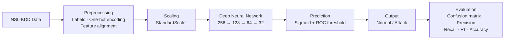

# AI-Driven Network Intrusion Detection System Using Deep Learning

## Description

This project implements a binary network intrusion detection model using an Artificial Neural Network (ANN) trained on the **NSL-KDD** dataset. It classifies network connection records into two categories:

- **Normal (0):** legitimate network activity
- **Attack (1):** malicious or intrusive network activity

The workflow covers dataset loading, preprocessing, categorical feature encoding, feature alignment, standardization, class-imbalance handling, neural-network training, threshold-based classification, and performance evaluation.

> **Scope:** This is an offline, dataset-based IDS prototype. It does not capture live network packets or automatically block network traffic.

## Tech Stack

| Technology | Purpose |
|---|---|
| Python | Main implementation language |
| Pandas | Dataset loading and tabular preprocessing |
| NumPy | Numerical operations and array handling |
| TensorFlow / Keras | Neural-network construction and training |
| Scikit-learn | Feature scaling, class weights, ROC analysis, and evaluation metrics |
| Matplotlib | Training curves and result visualizations |
| Seaborn | Confusion-matrix heatmap |

## Architecture Diagram

The diagram below is embedded directly in this README using Mermaid, so GitHub can render it without a separate image file.



### Neural Network Configuration

| Stage | Configuration |
|---|---|
| Input | Number of encoded and scaled features |
| Hidden layer 1 | 256 neurons, ReLU, L2 regularization, Batch Normalization, Dropout (0.4) |
| Hidden layer 2 | 128 neurons, ReLU, L2 regularization, Batch Normalization, Dropout (0.3) |
| Hidden layer 3 | 64 neurons, ReLU, L2 regularization, Batch Normalization, Dropout (0.3) |
| Hidden layer 4 | 32 neurons, ReLU |
| Output | 1 neuron, Sigmoid |
| Loss | Binary Crossentropy |
| Optimizer | Adam (initial learning rate: 0.001) |
| Training limit | Up to 50 epochs; EarlyStopping may stop training earlier |
| Batch size | 256 |
| Validation | 20% of the supplied training data |

## Results

The figures below are taken directly from the saved execution outputs in the project's Google Colab notebook. They distinguish Keras' default-threshold evaluation from the later ROC-selected-threshold evaluation.

### Dataset and preprocessing

| Item | Training set | Test set |
|---|---:|---:|
| Original records | 125,973 | 22,544 |
| Original columns | 43 | 43 |
| Columns after one-hot encoding (including label) | 123 | 123 |
| Model input features | 122 | 122 |

The notebook removes the `difficulty` column, converts labels to Normal (0) and Attack (1), one-hot encodes categorical features, aligns test columns to the training columns, and standardizes features.

### Training results

| Metric | Notebook output |
|---|---:|
| Epochs completed | 50 |
| Final training accuracy (epoch 50) | 99.66% |
| Final validation accuracy (epoch 50) | 99.73% |
| Final training loss | 0.0157 |
| Final validation loss | 0.0138 |
| Balanced class weight — Normal (0) | 0.9353 |
| Balanced class weight — Attack (1) | 1.0743 |

### Test evaluation

Keras' `model.evaluate()` uses the default binary classification threshold:

| Metric | Value |
|---|---:|
| Test accuracy (default threshold) | 81.32% |
| Test loss | 1.5212 |

The notebook then selects a threshold using the ROC curve and Youden's J statistic:

| Metric | Value |
|---|---:|
| Selected threshold | **0.0031** |
| Threshold-based test accuracy | **85.91%** |
| Correct test predictions | 19,367 / 22,544 |

### Classification report at the selected threshold

| Class | Precision | Recall | F1-score | Support |
|---|---:|---:|---:|---:|
| Normal (0) | 0.78 | 0.93 | 0.85 | 9,711 |
| Attack (1) | 0.94 | 0.81 | 0.87 | 12,833 |
| Macro average | 0.86 | 0.87 | 0.86 | 22,544 |
| Weighted average | 0.87 | 0.86 | 0.86 | 22,544 |

### Confusion matrix

Rows represent actual classes; columns represent predicted classes.

|  | Predicted Normal | Predicted Attack |
|---|---:|---:|
| **Actual Normal** | 9,008 (TN) | 703 (FP) |
| **Actual Attack** | 2,474 (FN) | 10,359 (TP) |

The model detected 10,359 of 12,833 attack records. It missed 2,474 attacks (false negatives) and incorrectly flagged 703 normal records (false positives).

### Evaluation note

The notebook selects the ROC threshold using `y_test` and evaluates predictions on that same test set. Therefore, test labels influence threshold selection. The 85.91% figure is the observed result in this notebook, but it is **not an independent, untouched-test estimate**. A more rigorous evaluation would select the threshold using validation data, freeze it, and then evaluate once on the test set.

## Limitations and Improvements

### Current limitations

1. **Offline evaluation:** The implementation classifies records from a prepared dataset; it is not connected to live packet capture or real-time traffic monitoring.
2. **Binary classification:** All non-normal labels are mapped to the single `Attack` class. The model does not identify individual attack families.
3. **Dataset scope:** Results on NSL-KDD do not by themselves establish performance on modern production networks or unseen traffic environments.
4. **Threshold-selection leakage:** The current code selects the ROC threshold using test labels. Threshold selection should be moved to validation data.
5. **Preprocessing deployment:** The fitted encoder/feature schema and scaler need to be saved and reused consistently when predicting on new records.

### Possible improvements

- Select the classification threshold using validation data and preserve the test set for final evaluation.
- Report ROC-AUC and, where useful for class imbalance, Precision-Recall AUC.
- Evaluate per-attack-category performance using a multiclass approach.
- Test generalization on additional or more recent network-traffic datasets.
- Save the trained model and fitted preprocessing objects for repeatable inference.
- Add live traffic ingestion and monitoring as a separate future development stage.
- Compare the ANN against suitable baseline models.

## Reproducibility

1. Install the required libraries: `pandas`, `numpy`, `tensorflow`, `scikit-learn`, `matplotlib`, and `seaborn`.
2. Download the NSL-KDD files `KDDTrain+.txt` and `KDDTest+.txt` and place them where the notebook can access them.
3. Open the notebook in Google Colab or Jupyter and run the cells in order.

## Repository Structure

```text
.
├── Code/
│   ├── AI_Intrusion_Detection_System.py\n│   └── AI-Driven-IDS-Execution-Colab-File.ipynb
├── Architecture/
│   └── System_Architecture.md
├── README.md
└── LICENSE
```

## License

This project is distributed under the MIT License. See the [LICENSE](LICENSE) file for details.

The code license does not automatically apply to the NSL-KDD dataset. Refer to the dataset provider's terms for dataset usage and redistribution.
