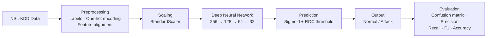

# AI-Driven Network Intrusion Detection System Using Deep Learning

## Description

This project implements a binary network intrusion detection model using an Artificial Neural Network (ANN) trained on the **NSL-KDD** dataset. It classifies network connection records into two categories:

- **Normal (0):** legitimate network activity
- **Attack (1):** malicious or intrusive network activity

The workflow covers dataset loading, preprocessing, categorical feature encoding, feature alignment, standardization, class-imbalance handling, neural-network training, threshold-based classification, and performance evaluation.

> **Scope:** This is an offline, dataset-based IDS prototype. It does not capture live network packets or automatically block network traffic.

## Tech Stack

| Technology | Purpose |
|---|---|
| Python | Main implementation language |
| Pandas | Dataset loading and tabular preprocessing |
| NumPy | Numerical operations and array handling |
| TensorFlow / Keras | Neural-network construction and training |
| Scikit-learn | Feature scaling, class weights, ROC analysis, and evaluation metrics |
| Matplotlib | Training curves and result visualizations |
| Seaborn | Confusion-matrix heatmap |

## Architecture Diagram

The diagram below is embedded directly in this README using Mermaid, so GitHub can render it without a separate image file.



### Neural Network Configuration

| Stage | Configuration |
|---|---|
| Input | Number of encoded and scaled features |
| Hidden layer 1 | 256 neurons, ReLU, L2 regularization, Batch Normalization, Dropout (0.4) |
| Hidden layer 2 | 128 neurons, ReLU, L2 regularization, Batch Normalization, Dropout (0.3) |
| Hidden layer 3 | 64 neurons, ReLU, L2 regularization, Batch Normalization, Dropout (0.3) |
| Hidden layer 4 | 32 neurons, ReLU |
| Output | 1 neuron, Sigmoid |
| Loss | Binary Crossentropy |
| Optimizer | Adam (initial learning rate: 0.001) |
| Training limit | Up to 50 epochs; EarlyStopping may stop training earlier |
| Batch size | 256 |
| Validation | 20% of the supplied training data |

## Results

The following values are transcribed from the project's final report, `MDP_Report_IDS.docx`.

### Dataset

| Item | Training set | Test set |
|---|---:|---:|
| Samples | 125,973 | 22,544 |
| Normal records | 67,343 | 9,711 |
| Attack records | 58,630 | 12,833 |
| Encoded columns including label | 123 | 123 |
| Model input features | 122 | 122 |

### Reported model performance

| Metric | Reported value |
|---|---:|
| Training accuracy (separate threshold-based summary) | 97.21% |
| Validation accuracy (epoch 50 training history) | 99.71% |
| Test accuracy (Youden-threshold predictions) | **85.81%** |
| Selected Youden J threshold | 0.0031 |
| Normal precision | 0.77 |
| Normal recall | 0.95 |
| Normal F1-score | 0.85 |
| Attack precision | 0.95 |
| Attack recall | 0.79 |
| Attack F1-score | 0.86 |
| Macro-average F1-score | 0.86 |
| Weighted-average F1-score | 0.86 |

### Confusion matrix

Rows are actual labels; columns are predicted labels.

|  | Predicted Normal | Predicted Attack |
|---|---:|---:|
| **Actual Normal** | 9,212 (TN) | 499 (FP) |
| **Actual Attack** | 2,699 (FN) | 10,134 (TP) |

The model correctly classified 19,346 of 22,544 test records, giving 85.81% accuracy at the selected threshold.

### Important evaluation qualification

The supplied implementation computes the ROC curve using `y_test`, selects the Youden J threshold from that curve, and then reports predictions on the same test set. Therefore, the test labels influence threshold selection. The 85.81% result is the report's observed result, but it is **not an unbiased, untouched-test estimate**. For a rigorous evaluation, select the threshold on validation data, freeze it, and evaluate once on the test set.

The report also contains two different training-accuracy contexts: 97.21% in its threshold-based accuracy summary and 99.65% as the epoch-50 Keras training-history accuracy. These are not directly interchangeable because they come from different calculation contexts/decision thresholds. They are labelled separately above rather than merged.

See [the results and methodology notes](Reports/Final_Results.md) for additional context.

## Limitations and Improvements

### Current limitations

1. **Offline evaluation:** The implementation classifies records from a prepared dataset; it is not connected to live packet capture or real-time traffic monitoring.
2. **Binary classification:** All non-normal labels are mapped to the single `Attack` class. The model does not identify individual attack families.
3. **Dataset scope:** Results on NSL-KDD do not by themselves establish performance on modern production networks or unseen traffic environments.
4. **Threshold-selection leakage:** The current code selects the ROC threshold using test labels. Threshold selection should be moved to validation data.
5. **Preprocessing deployment:** The fitted encoder/feature schema and scaler need to be saved and reused consistently when predicting on new records.

### Possible improvements

- Select the classification threshold using validation data and preserve the test set for final evaluation.
- Report ROC-AUC and, where useful for class imbalance, Precision-Recall AUC.
- Evaluate per-attack-category performance using a multiclass approach.
- Test generalization on additional or more recent network-traffic datasets.
- Save the trained model and fitted preprocessing objects for repeatable inference.
- Add live traffic ingestion and monitoring as a separate future development stage.
- Compare the ANN against suitable baseline models.

## Reproducibility

### 1. Clone the repository

```bash
git clone https://github.com/SujitSaiY2007/AI-Driven-Intrusion-Detection-System-Using-DeepLearning.git
cd AI-Driven-Intrusion-Detection-System-Using-DeepLearning
```

### 2. Install dependencies

Use Python 3 and install the libraries used by the implementation:

```bash
pip install pandas numpy tensorflow scikit-learn matplotlib seaborn jupyter
```

For repeatable experiments, record and pin the exact package versions used in the environment in a `requirements.txt` file.

### 3. Obtain the dataset

Download the NSL-KDD dataset from its legitimate distribution source. Place the following files in the repository root (the paths expected by the script):

- `KDDTrain+.txt`
- `KDDTest+.txt`

The dataset is not included in this repository. Review the dataset source's terms before redistribution.

### 4. Run the implementation

Run the complete Python script from the repository root:

```bash
python Code/AI_Intrusion_Detection_System.py
```

Confirm that `KDDTrain+.txt` and `KDDTest+.txt` are present in the current working directory before execution.

### 5. Reproducibility considerations

- The supplied code does not explicitly set Python, NumPy, and TensorFlow random seeds. Neural-network results may therefore vary between runs.
- Record the Python and library versions, dataset source, and execution environment alongside reported metrics.
- Keep the test set separate from threshold selection for an unbiased final evaluation.

## Repository Structure

```text
.
├── Code/
│   └── AI_Intrusion_Detection_System.py
├── Architecture/
│   └── System_Architecture.md
├── README.md
└── LICENSE
```

## License

This project is distributed under the MIT License. See the [LICENSE](LICENSE) file for details.

The code license does not automatically apply to the NSL-KDD dataset. Refer to the dataset provider's terms for dataset usage and redistribution.
